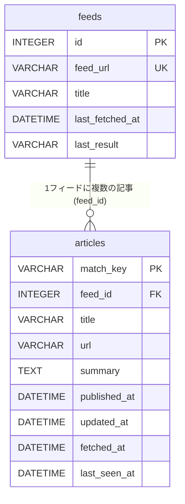

RSS新着収集スクリプト 概要設計
==============================

目的、背景、制約は、課題(`issue.md`)を参照します。

ファイル構成
-------------------------

```text
rss-news/                    スクリプトのあるディレクトリ
    news.mjs                 スクリプト本体(zx版。Node.js 24以上で実行します)
    news.php                 スクリプト本体(PHP版。PHP 8.2以上で実行します)
    news.py                  スクリプト本体(Python版。Python 3.11以上で実行します)
    package.json             zx版の依存パッケージ(XMLの解析とテンプレート)
    composer.json            PHP版の依存パッケージ(Twig)
    requirements.txt         Python版の依存パッケージ(Jinja2)
    tests/                   3つの版の統合テスト
        README.md            テストの実行方法
        run_tests.sh         3つの版を並列実行するテストランナー
        make_feed.py         テスト用Atomフィードの生成
        news_test.mjs        Node.js版(zx)の統合テスト
        news_test.php        PHP版の統合テスト
        news_test.py         Python版の統合テスト
    templates/
        news.md.j2           Markdownテンプレート(3つの版で共通)
        news.html.j2         HTMLテンプレート(3つの版で共通)
        news.txt.j2          テキストテンプレート(3つの版で共通)
    node_modules/            zx版の依存パッケージ(初回に自動導入)
    vendor/                  PHP版の依存パッケージ(初回に自動導入)
    python-vendor/           Python版の依存パッケージ(初回に自動導入)
    feeds.txt                フィード一覧(人が編集する設定)
    news.db                  SQLiteの記録

<ワーキングディレクトリ>/    スクリプトを実行したときのカレントディレクトリ
    news.md                  最新の新着
    news/                    新着がある実行ごとの複製(ディレクトリ名は定数で変更できます)
        2026-10-10_0839.md
    run.log                  cronの実行ログ(cronの設定で出力先を決めます)
```

- `tests/`は、テスト用フィードを生成し、3つの版を並列実行する統合テストです。
- 同じ設計を、複数のランタイム(zx版、PHP版、Python版)で実装します。
    - どの版も、同じ`feeds.txt`と`news.db`を使い、出力も同じです。
    - 運用者は、いずれか1つを選んで実行します。
- 置き場所は、運用者が決めます。
- `feeds.txt`と`news.db`は、スクリプトのある場所を基準に扱います。
- `news.md`と`news/`は、実行したときのワーキングディレクトリを基準に書き出します。
    - cronでは、`cd`でワーキングディレクトリを指定してから実行します。
- `feeds.txt`のパスは`NEWS_FEEDS_PATH`で上書きできます。
- `news.db`のパスは`NEWS_DB_PATH`で上書きできます。
- `news.md`と`news/`のパスは`NEWS_OUTPUT_PATH`と`NEWS_DIR_PATH`で上書きできます。

フィードの設定
-------------------------

`feeds.txt`で、取得するフィードを管理します。
フィード設定ファイルのパスは、既定ではスクリプトのあるディレクトリの`feeds.txt`です。
`NEWS_FEEDS_PATH`環境変数で上書きできます。

- 1行に1URLを書きます。
- URLの後ろに空白かタブを入れて、表示名を書けます(省略できます)。
    - 表示名は、`news.md`の見出しに使います。
    - 省略すると、フィード自身のタイトルを使います。
    - 表示名は、DBには保存せず、実行のたびに`feeds.txt`から読みます。
- `#`で始まる行は、コメントです。
- フィードの追加と削除は、ここだけで行います。

初期の登録は、次の2本です。

```text
# Publickey
https://www.publickey1.jp/atom.xml
# 技術評論社 gihyo.jp
https://gihyo.jp/feed/atom
```

- 初回の実行では、各フィードに残っている記事が大量にあります。
    - 既定の2本では、約890件です。
    - 内訳は、Publickey 15件、gihyo.jp 872件でした(2026-10-14時点の参考値)。
    - 件数はフィードの更新状況で変動します。
    - 全件を新着として出さないため、次の「初回取得の扱い」で出す記事を期間で絞ります。
- URLを書き換えた場合は、古いフィードの削除と、新しいフィードの追加として扱います。
    - 新しいフィードにも、「初回取得の扱い」を適用します。

対応するフィード形式
-------------------------

対応する形式は、RSS 2.0とAtom 1.0です。

- RSS 1.0(RDF)とJSON Feedには、対応しません。
- GUIDは、RSS 2.0では`guid`、Atom 1.0では`id`を使います。

次のように、必要な項目が欠けた記事は、取り込み方を決めておきます。

- GUIDと記事URLの両方がない記事は、照合キーを作れないため、取り込みません。
    - 取り込まなかった記事は、実行ログに記録します。
- タイトルがない記事は、記事URLをタイトルとして使います。
- 公開日時と更新日時の両方がない記事は、日付なしの記事として扱います。
    - 初回取得では、期間より古い記事として扱います。

初回取得の扱い
-------------------------

フィードを初めて取得する実行(初回取得)では、出す記事を期間で絞ります。

- 対象: `feeds`テーブルの`last_fetched_at`が空のフィードです。
    - 該当するのは、`feeds.txt`に追加した直後のフィードと、前回までの取得がすべて失敗したフィードです。
- 期間: スクリプト内の定数で決めます(定数名の例: `INITIAL_DAYS`)
    - 初期値は、7です。
    - 0: 期間で絞らず、すべての記事を新着として出します。
    - 1以上: 記事の日付が、取得日時から`INITIAL_DAYS`日以内の記事だけを、新着として出します。
- 期間より古い記事は、`news.md`には出さず、`articles`テーブルにだけ登録します。
    - 登録しておくことで、次回以降に新着として再び出ることを防ぎます。
- 日付が取れない記事は、期間より古い記事として扱います。
- 記事の日付は、「出力」の`news.md`に添える日付と同じです。
    - 公開日と更新日のうち新しい方を使います。

日時の扱い
-------------------------

内部の保存と比較は、UTCの日時で行います。
人が目にする表示は、日本時間に固定します。

- 保存と比較: DBの日時と、記事の更新の判定、初回取得の期間の判定は、UTCの日時(時刻まで含む)で行います。
    - 日付だけで比べると、同じ日のうちに更新された記事を見逃すためです。
- 表示: 次の3つは、日本時間で表示します。
    - `news.md`の1行目の取得日時
    - `news/`の複製のファイル名に入れる取得日時
    - 記事に添える日付(日時を日本時間に直したあとの日付)
- 日本時間への固定は、スクリプト内の定数で決めます(定数名の例: `TIMEZONE`)。
    - 初期値は、`Asia/Tokyo`です。
    - 実行環境のタイムゾーンには依存しません。
- フィードの日時は、タイムゾーンの表記が違う(`Z`や`+09:00`)ため、読み込み時にUTCへそろえます。

出力
-------------------------

既定の出力はMarkdownです。HTMLとテキストは、テンプレートおよび出力ファイル名を切り替えて出力します。

### news.md

- 実行のたびに、全体を上書きします。
- 新着がある場合は、新着だけを書き出します。
- 新着が0件の場合は、1行目を「新着0件(取得: 2026-10-10 08:39)」にし、新着の節は出しません。
- 取得に失敗したフィードがある場合は、新着の有無にかかわらず、末尾にその節を付けます。
- 上書きで前回の新着が消えるため、先頭に`news/`への案内を1行入れます。

```markdown
新着3件(取得: 2026-10-10 08:39)

前回までの新着は、`news/`の複製を参照してください。

### Publickey

- [記事タイトル](https://example.com/article1) (2026-10-09)
- [記事タイトル](https://example.com/article2) (2026-10-08)

### @IT

- [記事タイトル](https://example.com/article3) (2026-10-09)

### 取得に失敗したフィード

- https://example.com/feed.xml: 失敗の理由
```

- フィード名(表示名)ごとにまとめ、記事タイトルをリンクにして、日付を添えます。
    - 日付は、公開日と更新日のうち、新しい方です。
    - どちらも取れない記事は、日付を付けません。
- 並び順: フィードごとにまとめ、フィードの中は、添える日付の順に並べます。
    - フィードの並びは、`feeds.txt`の順です。
    - 新しい順にするか、古い順にするかは、スクリプト内の定数で決めます。
    - 初期値は、新しい順です。
- Markdownが崩れないように、タイトルの`[`と`]`はエスケープします。
    - タイトルの改行は、空白1つに置き換えます。
    - 記事URLの`)`と空白は、パーセントエンコードします。
- 記事の概要は、現状は載せません。
- 将来の要約・スコアリング構想は、「検討事項」を参照します。

### news/ディレクトリ

- 新着がある実行のときだけ、`news.md`の複製を作ります。
    - 前回の新着が`news.md`から消えても、ここから読めます。
- 置き場所は、ワーキングディレクトリの下の`news/`です。
    - ディレクトリ名は、スクリプト内の定数で変えられます(定数名: `NEWS_DIR`)。
    - 初期値は、`news`です。
    - 相対パスはワーキングディレクトリが基準で、絶対パスも指定できます。
    - `NEWS_DIR_PATH`環境変数でも上書きできます。
- ファイル名は、`news/2026-10-10_0839.md`のように、取得日時を入れます。

出力テンプレート
-------------------------

出力形式は、テンプレートで決めます。
既定はMarkdownで、次の3種類を用意しています。

- Markdown: `templates/news.md.j2` / `news.md`
- HTML: `templates/news.html.j2` / `news.html`
- テキスト: `templates/news.txt.j2` / `news.txt`

zx版、PHP版、Python版は、同じテンプレートを使います。

- テンプレートは、Twig、Jinja2、Nunjucksの共通サブセットで書きます。
- 使う記法は、`{{ }}`、``、``、``です。
- コンテキストは、次の値を持ちます。
    - `newsCount`: 新着の件数
    - `fetchedAt`: 取得日時
    - `newsDir`: 過去の複製を置くディレクトリ名
    - `feeds`: フィードの配列
        - `name`: フィードの表示名
        - `title`: フィード自身のタイトル
        - `url`: フィードのURL
        - `entries`: 記事の配列
            - `title`: 記事のタイトル(生の値)
            - `url`: 記事のURL(生の値)
            - `hasUrl`: URLがある場合だけ`true`
            - `isHttpUrl`: URLがhttpまたはhttpsの場合だけ`true`
            - `titleMarkdown`: Markdown用にエスケープしたタイトル
            - `urlMarkdown`: Markdown用にエスケープしたURL
            - `date`: 記事の日付
            - `hasDate`: 日付がある場合だけ`true`
            - `dateSuffix`: 日付がある場合だけ`(YYYY-MM-DD)`
    - `failures`: 取得に失敗したフィードの配列(`url`、`reason`)
    - `hasFailures`: 失敗したフィードがある場合だけ`true`
- `titleMarkdown`と`urlMarkdown`は、既定のMarkdownテンプレート用です。
- HTMLとテキストでは、`title`および`url`を使います。
- HTMLを出力する場合は、出力ファイル名の拡張子を`.html`または`.htm`にします。
    - テンプレートの値は、自動でHTMLエスケープされます。
- `news/`の複製の拡張子は、出力ファイル名の拡張子に合わせます。
- 形式を変える場合は、各スクリプトの`NEWS_TEMPLATE`と`NEWS_OUTPUT`を変更します。
- `NEWS_TEMPLATE_PATH`環境変数は、テンプレートのパスを上書きします。
- `NEWS_OUTPUT_PATH`環境変数は、出力ファイルのパスを上書きします。
- 環境変数が設定されている場合は、`NEWS_TEMPLATE`と`NEWS_OUTPUT`より優先します。
    - テンプレートの相対パスは、スクリプトのあるディレクトリが基準です。
    - 出力ファイルの相対パスは、ワーキングディレクトリが基準です。
- 依存パッケージが不足している場合は、初回の実行時に自動で導入します。
    - zx版: `npm install`
    - PHP版: `composer install`
    - Python版: `uv pip install --python python3 --target python-vendor -r requirements.txt`(uvがない場合はpipを使用)
    - 自動導入を止める場合は、`AUTO_INSTALL_DEPENDENCIES`を`false`にします。

データベース
-------------------------

DBのパスは、既定ではスクリプトのあるディレクトリの`news.db`です。
`NEWS_DB_PATH`環境変数で上書きできます。
日時の列は、`DATETIME`で宣言し、`2026-10-10 08:39:00`の形式(UTC)で扱います。
この形式は、SQLiteとMySQLのどちらでも、日時として比較できます。



### feedsテーブル

スクリプトが更新する状態です。
手で編集しません。
`feeds.txt`から消したフィードの記事を、カスケード削除で自動的に消すために持ちます。

- `id`: フィードID(主キー。整数の連番)
- `feed_url`: フィードのURL(`UNIQUE`制約)
- `title`: フィード名。フィード自身のタイトルです
- `last_fetched_at`: 最後の取得が成功した日時。失敗した実行では更新しません
- `last_result`: 最後に取得したときの結果。実行のたびに上書きします
    - 成功: `ok`
    - 失敗: 失敗の理由。例: `HTTP 404`、`timeout`、`parse error`

### articlesテーブル

取り込み済みの記事です。
新着かどうかは、このテーブルとの照合だけで決まります。

- `match_key`: 照合キー(主キー)
    - GUIDがある記事: `guid:`にGUIDを続けた値
    - GUIDがない記事: `url:`に記事URLを続けた値
    - GUIDがある記事は、URLを照合に使いません。
    - 理由: 同一URLの記事を含むフィードがあるためです。
- `feed_id`: `feeds`テーブルの`id`を参照する外部キー(`ON DELETE CASCADE`)
    - 同じ記事が複数のフィードにある場合は、最初に取り込んだフィードの値が残ります。
    - 更新された記事でも、値は変えません。
- `title`: 記事タイトル
- `url`: 記事URL
- `summary`: 記事の概要
    - 取得元: RSSは`description`、Atomは`summary`(なければ`content`)です。
    - どちらもなければNULLです。
    - 加工: HTMLタグを除き、最大500文字で切って保存します。
    - 用途: 今は`news.md`に出さず、保存だけします。
    - 保存する理由: 将来の機能拡張で、要約の生成、ベクトル化、興味に合わせたスコアリングへ活用する予定のためです。
- `published_at`: 公開日時
    - 取得元: RSSは`pubDate`、Atomは`published`です。
    - 取れない場合は、NULLです。
- `updated_at`: 更新日時
    - 取得元: Atomの`updated`です。
    - RSS 2.0には、該当する項目がないため、NULLです。
- `fetched_at`: 取得日時
    - 最初に取り込んだ日時です。
    - 更新された記事でも、値は変えません。
- `last_seen_at`: 最後までフィードに載っていた日時
    - 実行のたびに、取得結果に載っていた記事の値を、その実行の日時に更新します。
    - 古い記事の削除の判定に使います。

記事の日付は、列ではなく、`published_at`と`updated_at`のうち新しい方の日付です。
一方が空なら、もう一方の日付です。
`news.md`に添える日付と、更新の判定に使います。

### last_seen_atを持つ理由

古い記事の削除を、取得日時(`fetched_at`)ではなく、`last_seen_at`で判定するために持ちます。
`fetched_at`で判定すると、フィードにまだ載っている記事も、保持日数を過ぎると削除されます。
削除された記事は、次の実行で新着として再び出てしまいます。

フィードに記事が載り続ける期間は、サイトによって大きく違います。
2026-10-14時点の参考値では、Publickey約2週間分(15件)、gihyo.jp約13か月分(872件)でした。
件数はフィードの更新状況で変動します。
最長のフィードに合わせて保持日数を決めると、短いフィードの古い記事がいつまでも残ります。
そのため、記事ごとの「最後までフィードに載っていた日時」を持ちます。

`last_seen_at`は、フィードに載っている間は、実行のたびに更新されます。
そのため、載っている記事は削除されません。
フィードから外れた記事だけが、保持日数を過ぎたあとに削除されます。

代わりに、列が1つ増え、実行のたびに、載っている記事の分だけ更新が発生します。
更新の件数は、既定の2本で約890件です。

### DDL

SQLiteとMySQLの両方で動く書き方にしています。

- `id`の自動採番だけは、DBごとに書き方が違います。
    - 下のDDLは、SQLite用です。
    - MySQLでは、`id INT AUTO_INCREMENT PRIMARY KEY`と書きます。

```sql
CREATE TABLE IF NOT EXISTS feeds (
    id              INTEGER PRIMARY KEY,
    feed_url        VARCHAR(255) NOT NULL UNIQUE,
    title           VARCHAR(255),
    last_fetched_at DATETIME,  -- 最後に取得に成功した日時
    last_result     VARCHAR(255)  -- 最後の取得結果: ok または失敗の理由
);

CREATE TABLE IF NOT EXISTS articles (
    match_key    VARCHAR(255) PRIMARY KEY,
    feed_id      INTEGER NOT NULL,
    title        VARCHAR(255) NOT NULL,
    url          VARCHAR(255) NOT NULL,
    summary      TEXT,
    published_at DATETIME,
    updated_at   DATETIME,
    fetched_at   DATETIME NOT NULL,
    last_seen_at DATETIME NOT NULL,  -- 最後にフィードに載っていた日時
    FOREIGN KEY (feed_id) REFERENCES feeds(id) ON DELETE CASCADE
);
```

処理の流れ
-------------------------

1. DBに接続する
    - SQLiteの場合は、直後に`PRAGMA foreign_keys = ON`を実行します。
    - 理由: SQLiteは外部キーが既定で無効で、トランザクションの中では設定できないためです。
2. `feeds.txt`と`feeds`テーブルを同期する(1つのトランザクション)
    - `feeds.txt`にだけあるURLを、`feeds`テーブルに追加します。
    - `feeds`テーブルにだけあるURLを、`feeds`テーブルから削除します。
    - `feeds.txt`が空、または読めない場合は、削除せずに中止します。
3. 各フィードを1本ずつ取得する
    - 取得に失敗したフィードは、`last_result`に理由を記録して、次へ進みます。
4. 新着を判定する
    - 各記事を`articles`テーブルと照合します。
    - 未登録の記事は、新着です。
    - 登録済みでも、フィードの記事の日付が、保存した記事の日付より新しい記事は、更新された新着として扱います。
    - 同じ実行内の重複は、1件だけ残します。
    - 残す記事は、`feeds.txt`の上の行のフィードの記事です。
    - 初回取得のフィードは、期間より古い未登録の記事を新着に含めず、登録だけを行います。
5. 新着を書き出す
    - `news.md`に書き出します。
    - 新着がある場合は、`news/`に複製を作ります。
6. DBを更新する(1つのトランザクション。最後にコミット)
    - 新着を、`articles`テーブルに追記します。
    - 更新された記事は、登録済みの行を更新します。
    - 初回取得で期間より古かった記事も、`articles`テーブルに追記します。
    - 取得に成功したフィードの記事のうち、取得結果に載っていたものの`last_seen_at`を更新します。
    - 取得に成功したフィードの`title`、`last_fetched_at`、`last_result`を更新します。
7. 古い記事を削除する(保持日数が1以上の場合のみ)
    - 別のトランザクションで行います。
    - 失敗しても、手順6の追記には影響しません。

### 書き出しとDB更新の順序

- ファイルの書き出し(手順5)を先に行い、DBへの追記(手順6)を後にします。
- 理由: ファイルは取り消せないため、コミットを最後にします。
- DBの更新が失敗した場合: すべて取り消され、次回の実行で同じ記事が再び新着になります。

### 途中で失敗したとき

- トランザクションをロールバックします。
- エラーを`run.log`に記録して終了します。

古い記事の削除
-------------------------

DBが大きくなりすぎるのを防ぐ、任意の機能です。

- 保持日数: スクリプト内の定数で決めます(定数名の例: `KEEP_DAYS`)
    - 0: 削除しません(初期値)。
    - 1以上: `last_seen_at`が保持日数より前の`articles`テーブルの行を削除します。
    - 例: 90なら、90日より前にフィードから外れた記事の記録を削除します。
- `news/`の複製は、削除しません。

### 保持日数の決め方

- 削除の対象は、フィードから外れた記事だけです。
    - フィードに載っている間は、`last_seen_at`が更新されるため、削除されません。
- 保持日数は、フィードから外れた記事の記録を、何日残すかを決める値です。
- 短すぎると、外れたあとで再びフィードに載った記事が、新着として再び出ます。
- 取得の失敗が保持日数を超えて続くと、そのフィードの記事は`last_seen_at`が進みません。
    - その場合、復旧後に、記事が新着として再び出ることがあります。

定期実行
-------------------------

定期実行は、任意です。
スクリプトは単体で実行でき、手動で実行してもかまいません。

定期的に実行したい場合は、運用する人がcronなどで設定します。
実行時刻も、運用する人が決めます。
フィードの更新が頻繁なため、設定する場合は、1日2回以上を目安にします。

### cronの設定例

crontabに、スクリプトを呼び出す行を1行登録します。
次は、crontabの例です(使う版の1行だけを登録します)。
`~/rss-news`は置き場所に合わせて書き換えます。
平日だけなら、曜日の欄を`1-5`にします。

```text
0 11,17 * * * cd ~/rss-news && zx news.mjs >> run.log 2>&1
0 11,17 * * * cd ~/rss-news && php news.php >> run.log 2>&1
0 11,17 * * * cd ~/rss-news && python3 news.py >> run.log 2>&1
```

cronが動くLinux環境で実行することを前提にします。
cronの設定方法やサービス名は、利用するLinux環境のドキュメントを参照してください。

設定する値
-------------------------

運用者が変えられる値は、スクリプトの先頭にある定数です。
一部は環境変数でも上書きできます。
zx版、PHP版、Python版で、定数名と意味は共通です。

### 定数

定数は、スクリプトを編集して変更します。

- `KEEP_DAYS`: 古い記事を削除するまでの日数(0なら削除しません。初期値は0)
- `INITIAL_DAYS`: 初回取得のフィードで、新着として出す期間の日数(0なら絞りません。初期値は7)
- `NEWEST_FIRST`: フィード内の並び順(新しい順なら`true`。初期値は`true`)
- `TIMEZONE`: 画面に出す日時のタイムゾーン(初期値は`Asia/Tokyo`)
- `FETCH_TIMEOUT_SECONDS`: フィード1本あたりの取得のタイムアウト秒数(初期値は30)
- `NEWS_DIR`: 過去の`news.md`の複製を置くディレクトリ(初期値は`news`)
- `SUMMARY_MAX_LENGTH`: `summary`に保存する最大文字数(初期値は500)
- `NEWS_TEMPLATE`: 出力テンプレートのファイル名(初期値は`news.md.j2`)
- `NEWS_OUTPUT`: 出力ファイルの既定パス(初期値は`news.md`)

### 環境変数

環境変数は、スクリプトを編集せずに実行時だけ設定を変えたい場合に使います。

- `NEWS_TEMPLATE_PATH`: テンプレートのパスを上書きします。
    - 相対パスは、スクリプトのあるディレクトリが基準です。
    - 設定時は`NEWS_TEMPLATE`より優先します。
- `NEWS_OUTPUT_PATH`: 出力ファイルのパスを上書きします。
    - 相対パスは、ワーキングディレクトリが基準です。
    - 設定時は`NEWS_OUTPUT`より優先します。
- `NEWS_FEEDS_PATH`: フィード設定ファイルのパスを上書きします。
    - 相対パスは、スクリプトのあるディレクトリが基準です。
- `NEWS_DB_PATH`: DBのパスを上書きします。
    - 相対パスは、スクリプトのあるディレクトリが基準です。
- `NEWS_DIR_PATH`: 複製ディレクトリのパスを上書きします。
    - 相対パスは、ワーキングディレクトリが基準です。

受け入れ確認
-------------------------

課題の完了条件を満たしているかを、次の項目で確認します。

- 手軽さ: 引数なしの1コマンドで実行でき、`news.md`が生成されること
- 形式切り替え: `NEWS_TEMPLATE`と`NEWS_OUTPUT`を変更すると、HTMLまたはテキストで出力できること
- 表示名: `feeds.txt`でURLの後ろに書いた表示名が、`news.md`の見出しになること(省略したフィードは、フィード自身のタイトルになること)
- 初回取得: 期間内(`INITIAL_DAYS`日以内)の記事だけが、新着として出ること
- 再実行: 2回続けて実行し、2回目の新着が0件になること
    - 「検討事項」の、更新日による再掲の確認を兼ねます。
- 新着0件: `news.md`の1行目が「新着0件」になり、`news/`への案内が付くこと
- 取得失敗: 取得に失敗したフィードがあっても、他のフィードの処理が続き、失敗の節に載ること
- フィードの削除: `feeds.txt`から消したフィードの記事が、カスケード削除で消えること
- 古い記事の削除: `KEEP_DAYS`を設定したとき、フィードに載っている記事は消えないこと
- パス分離: `NEWS_FEEDS_PATH`、`NEWS_DB_PATH`、`NEWS_OUTPUT_PATH`、`NEWS_DIR_PATH`でパスを変更できること
- 並列実行: パスを分けた状態で、3つの版を並列実行できること

検討事項
-------------------------

- カラムサイズ: DDLの255文字は目安です。
    - 桁数を超える値は、MySQLでは登録に失敗します。
    - MySQLでは、主キーと`UNIQUE`の列は、768文字前後が上限の目安です。
- 更新日による再掲:
    - 懸念: フィードによっては、記事を更新していないのに、`updated`の値が変わります。
    - その場合、毎回、すべての記事が新着として出ます。
    - 既定の2本: 値は記事ごとに異なり、取得時刻ではないことを確認済みです。
    - 既定の2本で、取得のたびに変わらないかは、未確認です。
    - 確認方法: 初回の試験で、2回続けて実行し、2回目の新着が0件になることを確認します。
    - 誤字の修正でも、記事は新着として再び出ます。
- 複数のフィードにある同じ記事:
    - 最初に取り込んだフィードを`feeds.txt`から消すと、カスケード削除で記事も消えます。
    - その記事が別のフィードにも載っている場合は、次の実行で新着として再び出ます。
- 興味に合わせたスコアリング(検討中):
    - 現状: `news.md`は記事タイトルだけを出し、`summary`は保存だけしています。
    - 方針: まずSystem Oneモデルによる判定を検討し、ベクトル検索は必要になった場合の代替案とします。
    - 要約: タイトルと`summary`を使い、`summary`が長い場合は3行程度にまとめます。
    - System Oneモデル: TypeSafe AIのJevなどの判定モデルを候補とし、タイトルと`summary`から興味との関連度をスコアや確率で受け取れるかを検証します。採用前に、公式情報で機能と利用条件を確認します。
    - 利点: 埋め込みの管理はモデル側に任せ、アプリ側ではベクトルデータを保持せず、外部APIとの連携だけで実現できます。
    - 外部API: モデルの利用時に、APIキー、送信データ、利用料金、失敗時の扱いを決めます。
    - ベクトル: タイトルと`summary`をベクトル化し、興味のある記事などのデータとの類似度を計算します。
    - 用途: 記事ごとに関連度のスコアを付け、並び替えや絞り込みに使います。
    - ベクトル格納: ベクトル方式を採用する場合、SQLiteは標準でベクトル型を持たないため、BLOB保存、`sqlite-vec`、外部DBなどを候補にします。
    - 3版共通: ベクトル方式をSQLite拡張で実装する場合、PHP版はPDO接続のためDB層の見直しが必要です。
    - モデル: 利用するモデル、判定精度、実行コストを確認します。
    - 位置づけ: 現状は検討段階であり、DBスキーマ、依存パッケージ、出力処理には反映しません。
